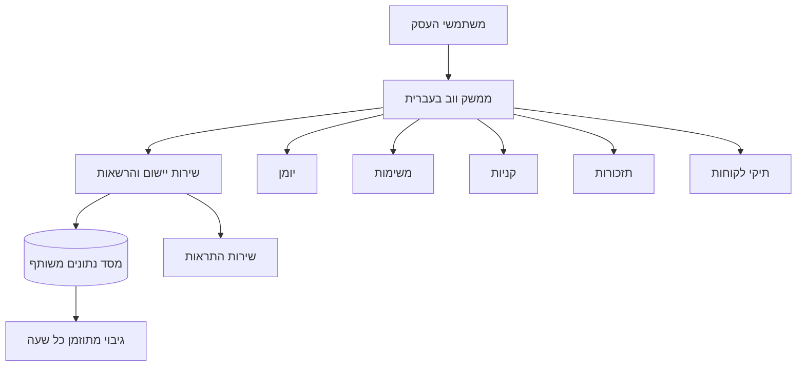

# תכנון ראשוני — מערכת לניהול עסק קטן־בינוני

## מטרת המערכת
יישום ווב בעברית, מותאם למחשב ולטלפון, לניהול העבודה היומיומית של צוות בעסק. הממשק ייבנה ב־HTML, CSS ו־JavaScript. אזורי העבודה יהיו מודולריים, כך שאפשר לפתח כל כלי בנפרד ולהוסיף כלים בעתיד.

## כלים בסבב הראשון
- יומן עבודה משותף
- רשימת משימות (To Do)
- רשימת קניות
- תזכורות אישיות וצוותיות
- תיקי לקוחות

## מבנה מוצע
כל משתמש נכנס לחשבון ארגוני משותף, ורואה את הכלים לפי ההרשאות שלו. לכל כלי יש מסך, זרימת עבודה ורכיבי ממשק משלו; היומן, המשימות והלקוחות יכולים לקשר זה לזה. מידע משותף יישמר בשרת אחד, ולא בדפדפן של משתמש יחיד.

## דרישות בסיס
1. **משתמשים והרשאות:** חשבונות נפרדים לעובדים; מנהל יכול להוסיף משתמשים ולהגדיר הרשאות.
2. **שיתוף ועדכון:** משתמשים רואים מידע משותף לאחר שמירה; ביומן ובמשימות נדרש רענון מהיר בין משתמשים.
3. **גיבוי:** גיבוי אוטומטי בכל שעה, שמור בנפרד ממסד הנתונים, עם אפשרות שחזור ובדיקות שחזור תקופתיות.
4. **פרטיות:** כל רשומה משויכת לארגון; הרשאות בצד השרת מונעות גישה לנתוני ארגון אחר.
5. **הרחבה:** כל כלי הוא מודול עצמאי שמתחבר לחשבונות, להרשאות ולנתונים המשותפים.

## החלטת ארכיטקטורה ראשונית
HTML לבדו מתאים לממשק, אך אינו מספיק לשיתוף אמין, לחשבונות משתמשים או לגיבוי שעתי. לכן המערכת תזדקק גם לשרת יישום, למסד נתונים משותף, לאימות משתמשים ולמשימה מתוזמנת לגיבוי. נבחר ספק אירוח ושירותים לאחר שנחליט על אופן ההפעלה והתקציב.

## שלבי פיתוח מוצעים
1. לסגור את מבנה המשתמשים, הארגון וההרשאות.
2. לבנות מעטפת אחידה עם ניווט בין מודולים.
3. לפתח כל כלי בשיחת עבודה נפרדת ולתעד את החלטותיו.
4. לחבר את הכלים למסד הנתונים המשותף ולוודא הרשאות ושיתוף.
5. להפעיל גיבוי שעתי, התראות ולבדוק שחזור לפני שימוש בנתונים אמיתיים.

## הנחות שצריך לאשר בהמשך
- עברית וכיווניות מימין לשמאל כברירת מחדל.
- המערכת תהיה זמינה דרך דפדפן, ולא תותקן כתוכנת שולחן עבודה.
- גיבוי שעתי הוא גיבוי נתונים שניתן לשחזר; משך השמירה ייקבע בהמשך.
- כלים עתידיים יתווספו כמודולים בלי לשנות את המבנה המרכזי.
